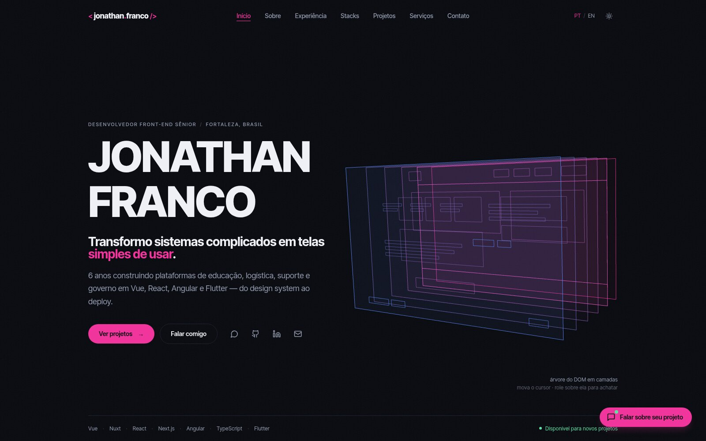

<div align="center">

# &lt;jonathan.franco /&gt;

**Portfólio de Jonathan Franco — desenvolvedor front-end sênior em Fortaleza, Brasil.**

Transformo sistemas complicados em telas simples de usar.


**[🌐 jonfrancodev.vercel.app](https://jonfrancodev.vercel.app)** · [LinkedIn](https://linkedin.com/in/jonathan-franco-dev/) · [GitHub](https://github.com/jonathanFranco)



</div>

---

## Destaques

- **Árvore do DOM em 3D** — o hero mostra a página como camadas empilhadas, renderizadas com Three.js. Elas seguem o cursor e se achatam conforme a rolagem.
- **Cenas com rolagem** — em telas grandes, cada seção fica fixa enquanto o conteúdo entra em sequência. Em telas pequenas, a página rola normalmente.
- **PT / EN** — rotas `/pt` e `/en`. O middleware escolhe o idioma pelo cookie ou pelo `Accept-Language` do navegador.
- **Tema claro e escuro**, com `next-themes`.
- **Chat de orçamento** — um roteiro guiado por botões monta o pedido e abre o WhatsApp com a mensagem pronta. Roda todo no navegador, sem backend.
- **Acessibilidade** — link "pular para o conteúdo" e elementos decorativos escondidos de leitores de tela com `aria-hidden`.

## Projetos em destaque

| Projeto | Área |
| --- | --- |
| [Homero](https://homero.app.br/) | Educação |
| [AVA Jovens Empreendedores Digitais](https://ava.empreendedoresdigitais.ifce.edu.br/) | Educação · IFCE |
| [Vai Boy](https://app.vaiboy.com.br/) | Logística |
| [Grupo Multi Suporte](https://suporte.grupomulti.com.br) | Suporte |
| [Grupo Multi Governo](https://governo.grupomulti.com.br/) | Setor público |
| [Fortal Connect](https://fortalconnect.com.br/) | Tecnologia · Institucional |
| [Bora Assistir](https://boraassistir.vercel.app/pt) | Projeto próprio |
| [Pirataflix](https://pirataflix.netlify.app) | Projeto próprio |

## Rodando localmente

Requer Node 18 ou mais recente.

```bash
pnpm install
cp .env.example .env.local   # opcional: o site roda sem ele
pnpm dev                     # http://localhost:3000
```

| Script | O que faz |
| --- | --- |
| `pnpm dev` | Servidor de desenvolvimento |
| `pnpm build` / `pnpm start` | Build e servidor de produção |
| `pnpm lint` | Lint do Next |

### Variáveis de ambiente

| Variável | Uso |
| --- | --- |
| `NEXT_PUBLIC_WHATSAPP_NUMBER` | Número que recebe os pedidos do chat (só dígitos, com DDI) |
| `NEXT_PUBLIC_SUPABASE_URL` / `NEXT_PUBLIC_SUPABASE_ANON_KEY` | Só para o backend de chat com IA (opcional, veja abaixo) |

> Tudo com prefixo `NEXT_PUBLIC_` vai para o bundle do navegador. Nunca coloque chaves secretas no `.env.local`.

## Estrutura

```
app/[lang]/          página única, layout e metadados por idioma
components/          seções da página, chat, cenas 3D e componentes de UI
lib/i18n/            dicionários PT e EN (todo o texto do site)
lib/chatbot/         roteiro do chat de orçamento (script.ts)
lib/scenes.ts        controlador das cenas com rolagem
middleware.ts        redireciona / para o idioma do visitante
supabase/            Edge Function de chat com Gemini (não usada pelo site hoje)
docs/                documentação e imagens do README
```

Para trocar textos, projetos ou experiências, edite `lib/i18n/dictionaries/pt.ts` e `en.ts`. Os projetos, com imagem e link, ficam em `components/projects-section.tsx`.

## Chat com IA (opcional)

O repositório também tem um backend de pré-venda com Gemini, rodando numa Edge Function do Supabase. Ele faz rate limit, guarda memória comprimida da conversa e calcula a faixa de preço sem passar pelo modelo. O site atual não usa esse backend. Arquitetura, deploy e decisões estão em [docs/CHATBOT.md](docs/CHATBOT.md).

---

<div align="center">
Feito por Jonathan Franco · Fortaleza, CE
</div>
